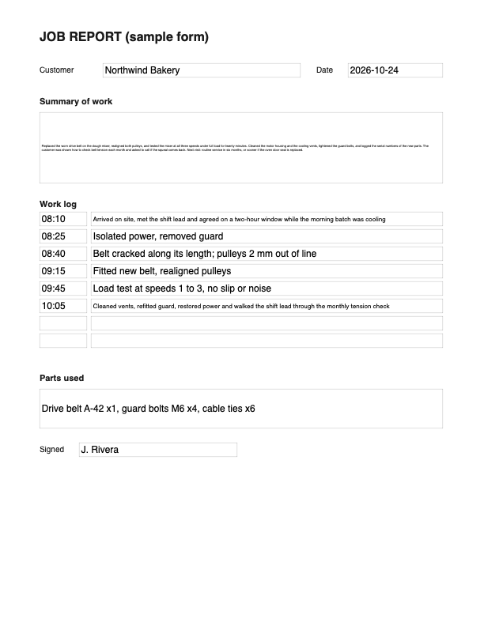

# AlimangoPDF

A small macOS app that makes filled PDF forms print cleanly. Long answers no longer get cut off at the edge of a box.

Click the app and choose a PDF, or drop PDFs on it. For each file it writes `<name> - PRINT.pdf` next to the original and opens it in Google Chrome, ready to print.

## What it does to a form

- **Wraps and shrinks text.** Tall text boxes become multi-line, and the font shrinks (11 pt down to 4 pt) until the text fits inside the box.
- **Merges row boxes.** A stack of numbered one-line boxes, such as a numbered list of note lines, becomes one paragraph box. The existing text is kept in row order.
- **Repairs forms saved by macOS Preview.** It points fields back at the boxes the pages actually show, registers stray text boxes, drops broken appearance entries, and rewrites unreadable streams with `qpdf` first.

It only edits form fields. The printed page content is left as it is.

The first run on a plain form gives `<name> - flexible.pdf`, a reusable template. Running it on that template (after filling it) gives `<name> - PRINT.pdf`.

## Sample

`samples/` has a made-up "Job Report" form (no real data):

| Filled form as typed | After AlimangoPDF |
| --- | --- |
|  |  |

On the left, the long summary is shrunk to an unreadable line and the work-log rows clip. On the right, the summary wraps to fit its box and the eight log rows become one paragraph box.

- `samples/sample-form.pdf`: the blank fillable form
- `samples/sample-filled.pdf`: the same form, filled in
- `samples/sample-filled - flexible.pdf`: the result
- `node samples/make-sample.cjs` rebuilds the two input PDFs

## Install (macOS, Apple silicon)

```sh
brew install node qpdf
git clone https://github.com/AlimangoStudio/alimangopdf.git
cd alimangopdf && ./build.sh          # installs to ~/Applications/AlimangoPDF.app
```

If you rebuild, the previous AlimangoPDF.app goes to the Trash.

## Command line

```sh
cd engine && npm ci
node make-flexible.cjs form.pdf [output.pdf]   # flexible template, or the PRINT copy of a filled one
node make-blank.cjs filled.pdf blank.pdf       # clears every field and tick, keeps the layout
```

## Notes

- Text is set in Helvetica (a standard PDF font), so it covers Latin text only.
- The engine expects `qpdf` at `/opt/homebrew/bin/qpdf`, the Homebrew path on Apple silicon.
- Built on [pdf-lib](https://github.com/Hopding/pdf-lib) (MIT).

MIT licensed. Made by Alimango Studio.

The Alimango name and the Alimango crab mark (the app icon) are trademarks of Alimango Studio. The MIT licence covers the code only, not the name or the mark. Forks must use their own name and icon.
